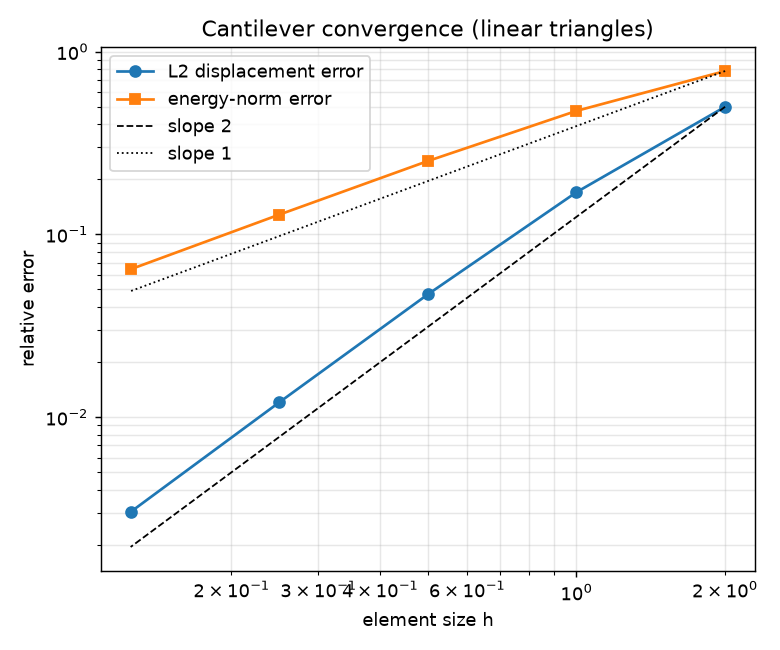
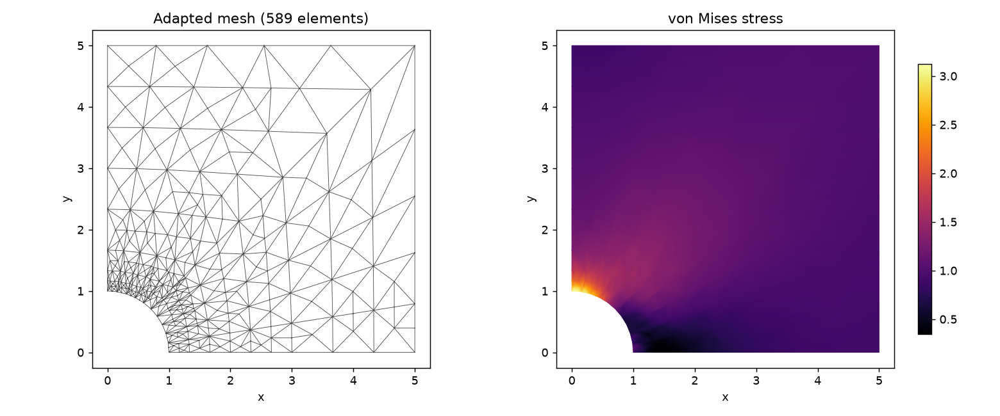
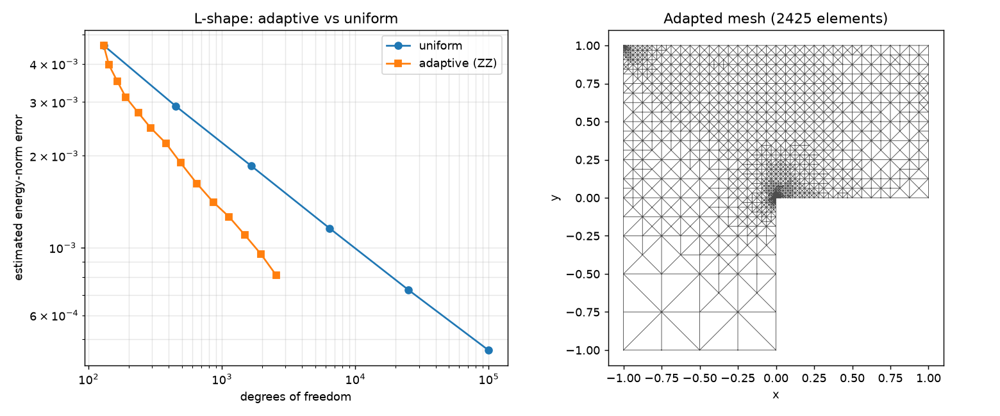

# fem2d-elasticity

**An open-source finite element solver for 2-D linear elasticity with Zienkiewicz–Zhu error estimation and adaptive mesh refinement.**

A small, readable, dependency-light (NumPy / SciPy) implementation of the full
finite element workflow for plane-stress and plane-strain elasticity on
triangular meshes — formulation, assembly, solution, stress recovery, a-posteriori
error estimation, and adaptive (longest-edge bisection) mesh refinement that
concentrates elements where the solution error is largest.

The library is deliberately compact and documented so it can be read as a
reference implementation, while being validated against closed-form benchmark
solutions (patch test, Timoshenko cantilever, Kirsch plate-with-hole).

---

## Highlights

- **3-node linear triangles (constant-strain triangles)** with the full
  `B`/`D` formulation for plane stress and plane strain.
- **Sparse global assembly** (SciPy `csr_matrix`) and direct solve, with
  Dirichlet, Neumann (edge traction), point-load and body-force boundary
  conditions.
- **Recovery-based (Zienkiewicz–Zhu) a-posteriori error estimation** in the
  energy norm — a *heuristic* indicator, not a guaranteed bound (see
  [Limitations](#limitations)).
- **Adaptive mesh refinement** via conforming Rivara *longest-edge bisection*
  with Dörfler (bulk) marking — no hanging nodes.
- **Benchmark mesh generators**: rectangle, L-shape, and a quarter plate with a
  circular hole.
- **Validated** against analytical solutions and classic convergence rates, with
  a full `pytest` suite.

---

## Installation

```bash
git clone https://github.com/vikranthacker/fem2d-elasticity.git
cd fem2d-elasticity
pip install -e .            # core: numpy, scipy
pip install -e ".[dev]"    # + matplotlib, pytest (to run examples and tests)
```

Python ≥ 3.10.

---

## Quick start

```python
import numpy as np
from felas import ElasticityProblem, Material, Mesh
from felas.recovery import recover_nodal_stress, von_mises

# A 8 x 4 plate, clamped on the left, pulled on the right.
mesh = Mesh.rectangle(width=8.0, height=4.0, nx=32, ny=16)
mat = Material(E=1000.0, nu=0.3, plane="stress")

problem = ElasticityProblem(mesh, mat)
problem.fix_nodes(mesh.nodes_where(lambda x, y: np.isclose(x, 0.0)))   # clamp left
right = mesh.boundary_edges()
right = right[np.all(np.isclose(mesh.nodes[right][:, :, 0], 8.0), axis=1)]
problem.add_edge_traction(right, lambda x, y: (10.0, 0.0))            # pull right

u = problem.solve()                                   # (n_nodes, 2) displacements
_, stress = problem.element_strain_stress(u)          # per-element stress (Voigt)
vm = von_mises(recover_nodal_stress(mesh, stress))    # smoothed nodal von Mises
```

Adaptive refinement in a few lines:

```python
from felas import adaptive_solve

def build(mesh):
    p = ElasticityProblem(mesh, mat)
    ...  # apply the same BCs/loads on the (possibly refined) mesh
    return p

result = adaptive_solve(mesh, build, mat, steps=8, theta=0.5, verbose=True)
print(result.history[-1])   # dofs and estimated error at the final step
```

---

## Examples & results

Run from the repository root (figures are written to `examples/figures/`):

```bash
python examples/01_cantilever_convergence.py
python examples/02_plate_with_hole.py
python examples/03_lshape_adaptive.py
```

### 1. Timoshenko cantilever — convergence

An end-loaded cantilever with a known exact solution. The FEM tip deflection
converges to the analytical value and the L2 displacement error decreases at the
expected `O(h²)` rate for linear triangles:

| dofs | h | FEM tip deflection | L2 error |
|-----:|-----:|-------------------:|---------:|
|   30 | 2.00 | −0.01858 | 4.98e-01 |
|   90 | 1.00 | −0.03103 | 1.70e-01 |
|  306 | 0.50 | −0.03572 | 4.69e-02 |
| 1122 | 0.25 | −0.03704 | 1.20e-02 |
| 4290 | 0.125| −0.03739 | 3.03e-03 |

Exact tip deflection `v(L, 0) = −0.0375`; observed L2 convergence rate ≈ **1.84 → 2.0**.



#### A bug I caught (and why it matters)

The first version of this convergence study had the FEM displacement error dropping
at the expected `O(h²)`, but the strain-**energy** error stubbornly plateaued near
2% — inconsistent with the clean displacement convergence. Rather than accept it, I
checked each number independently. The FEM strain energy was fine: it converged
monotonically from below at `O(h²)` toward the analytic value. The culprit was my
*reference*: the "exact" energy was being computed with a first-order
product-rectangle rule (~2% error), so the quantity I was validating *against* was
less accurate than the solution I was validating. Because the Timoshenko stress
field is polynomial, an exact tensor-product **Gauss–Legendre** rule gives the true
energy; switching to it (and reporting the energy-norm error via Galerkin
orthogonality, `‖u−u_h‖_E/‖u‖_E = √((U_exact−U_h)/U_exact)`) made the correct
`O(h)` energy-norm rate appear. The lesson I took from it: in a convergence study,
distrust your own reference the moment the "exact" value is the least accurate
number in the table.

### 2. Plate with a circular hole — stress concentration

Quarter model under remote uniaxial tension with symmetry boundary conditions.
The recovered hoop stress at the hole edge approaches the classic Kirsch stress
concentration factor:

> peak hoop stress at hole ≈ **3.06**  (Kirsch factor for an infinite plate = 3).



### 3. L-shaped domain — adaptive vs uniform refinement

The re-entrant corner produces a stress singularity. ZZ-driven adaptive
refinement concentrates elements at the corner and reaches a smaller error than
uniform refinement for the same number of degrees of freedom (here adaptive hits
`η ≈ 8e-4` at ~2.5k dofs, where uniform needs ~25k dofs):



---

## How it works

The solver assembles the global stiffness `K` from element matrices
`Kₑ = t · Aₑ · Bₑᵀ D Bₑ`, applies boundary conditions by static condensation of
the constrained degrees of freedom, and solves `K u = f` with a sparse direct
solver. Element stresses `σ = D B uₑ` are constant per triangle; averaging them
to the nodes gives a continuous recovered field `σ*`. The Zienkiewicz–Zhu
elementwise error indicator is the energy norm of `σ* − σ`:

```
ηₖ² = ∫ₖ (σ* − σ)ᵀ C⁻¹ (σ* − σ) dΩ ,   η = (Σ ηₖ²)^½
```

Dörfler marking selects the smallest set of elements carrying a fixed fraction of
`η²`, and those elements are refined by longest-edge bisection, which propagates
to neighbours as needed to keep the mesh conforming. A full derivation is in
[`docs/THEORY.md`](docs/THEORY.md).

---

## Project structure

```
fem2d-elasticity/
├── src/felas/
│   ├── materials.py        # isotropic material, plane-stress/strain D matrices
│   ├── mesh.py             # Mesh, generators, uniform & longest-edge refinement
│   ├── elements.py         # linear-triangle B matrix, stiffness, loads
│   ├── fem.py              # assembly, boundary conditions, solve, stresses
│   ├── recovery.py         # nodal stress recovery, von Mises
│   ├── error_estimator.py  # Zienkiewicz–Zhu error estimate
│   ├── adaptivity.py       # Dörfler marking + adaptive solve loop
│   ├── analytical.py       # Timoshenko & Kirsch reference solutions
│   └── plotting.py         # matplotlib helpers
├── examples/               # runnable demonstrations (produce the figures above)
├── tests/                  # pytest suite (patch test, convergence, conformity…)
└── docs/THEORY.md          # formulation and algorithms
```

---

## Testing

```bash
pytest -q
```

The suite covers the element formulation (rigid-body modes, constant-strain
reproduction), the **patch test** on a distorted mesh, mesh-refinement
conformity and area conservation, analytical-solution consistency, Timoshenko
convergence rates, and that adaptivity reduces the error and beats uniform
refinement.

---

## Limitations

This is a compact reference implementation, not a verified-computing library. Its
scope and honest caveats:

- **The ZZ error estimate is a heuristic, not a guaranteed bound.** It provides
  *no* proven upper or lower bound on the true error and no controlled
  effectivity index. Recovery-based estimators are asymptotically exact only for
  *smooth* solutions on sufficiently regular meshes; near the L-shape's
  re-entrant corner (a singularity) and along domain boundaries (where recovery
  patches are one-sided) the indicator is a proxy of unquantified fidelity. The
  "adaptive vs uniform" comparison plots the *estimated* error η, not a certified
  one. For rigorous, guaranteed error bounds see the computer-assisted /
  verified-FEM literature (e.g. Liu & Oishi; Kikuchi & Liu on interpolation
  error constants).
- **Stress recovery uses simple area-weighted nodal averaging**, not
  superconvergent patch recovery (SPR). SPR would materially improve the
  estimator's effectivity and is a natural next step.
- **Reported stress-concentration peaks** (e.g. the plate-with-hole example) are
  read from recovered nodal values at a boundary node, which carries a recovery
  bias; treat them as validated-to-engineering-accuracy, not exact.
- **Edge tractions** use the 2-node linear consistent load, which is exact only
  for tractions varying linearly along an edge; a quadratic traction (e.g. the
  cantilever end shear) incurs a harmless O(h²) consistency error.
- Only linear (P1 / CST) triangles are implemented; no higher-order elements,
  contact, nonlinearity, or dynamics.

## References

1. O. C. Zienkiewicz & J. Z. Zhu, *A simple error estimator and adaptive
   procedure for practical engineering analysis*, Int. J. Numer. Methods Eng.,
   24 (1987) 337–357.
2. M. C. Rivara, *Mesh refinement processes based on the generalized bisection
   of simplices*, SIAM J. Numer. Anal., 21 (1984) 604–613.
3. W. Dörfler, *A convergent adaptive algorithm for Poisson's equation*, SIAM
   J. Numer. Anal., 33 (1996) 1106–1124.
4. S. P. Timoshenko & J. N. Goodier, *Theory of Elasticity*, 3rd ed.,
   McGraw-Hill, 1970.

---

## License

MIT — see [LICENSE](LICENSE).
